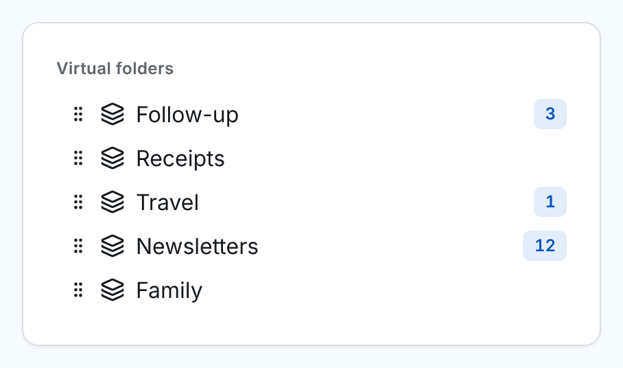
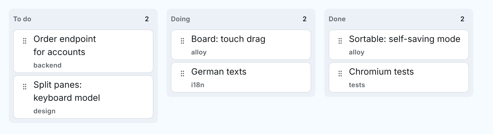
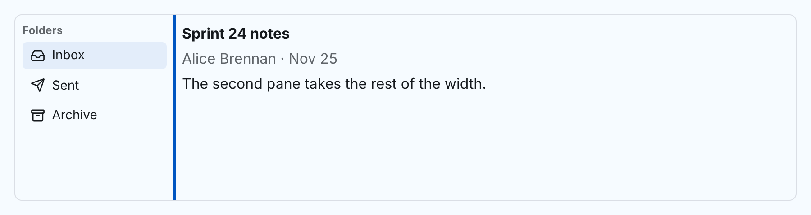
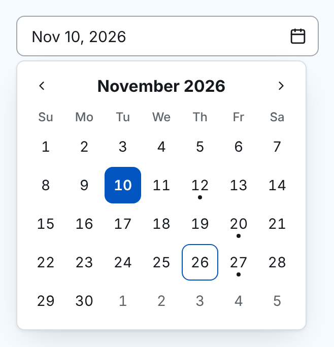
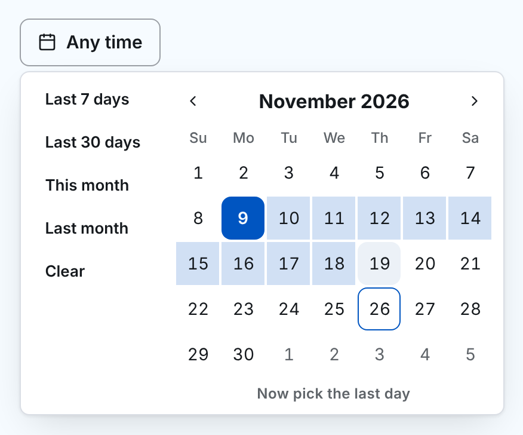
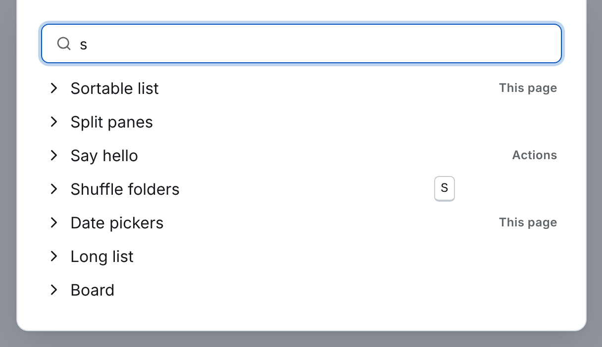
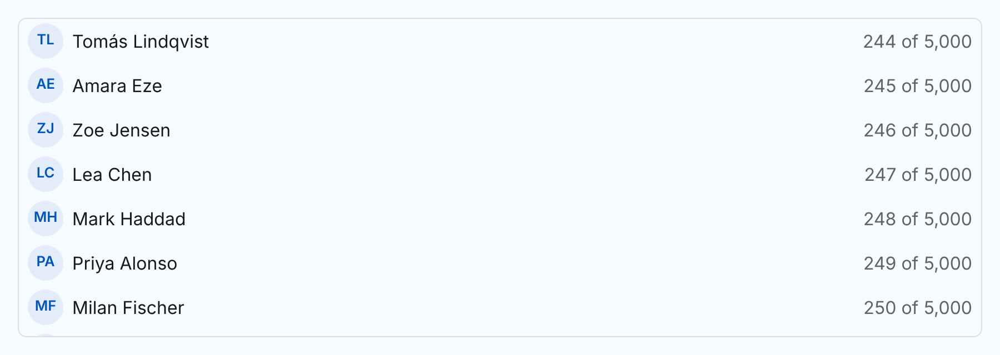

# @tiavision/sinter-alloy

Opinionated components for [sinter](https://github.com/tiaforge/sinter): the part of a UI that needs a script
because it cannot be written as attributes. Seven of them, all built. Built for [temper](https://github.com/tiaforge/temper) (a required peer),
first used by [caley](https://github.com/tiavision/caley).

| Component | Status |
| --- | --- |
| [`<alloy-sortable>`](#alloy-sortable) | built: a list reordered with a pointer (mouse, touch, pen) or the keyboard |
| [`<alloy-board>`](#alloy-board) | built: cards moved within and between columns |
| [`<alloy-split>`](#alloy-split) | built: two panes and a separator that keeps its size |
| [`<alloy-date>`, `<alloy-range>`, `<alloy-month>`](#dates) | built: dates in the page's language, a range in the URL |
| [`<alloy-palette>`](#alloy-palette) | built: a Ctrl+K command palette with no setup |
| [`<alloy-virtual>`](#alloy-virtual) | built: a long list over sinter's `append` pagination |

**[Preview](https://tiavision.github.io/sinter-alloy/)**: every component running live, built from `preview/` and
published to GitHub Pages on every push to `main`. The screenshots below are taken from it (`npm run screenshots`). The
design, the decisions and the open questions are in [docs/DESIGN.md](docs/DESIGN.md).

```html
<sn-resource name="tasks" src="/api/tasks" key="id" order="rank" type="Task[]"></sn-resource>

<alloy-sortable data-sn-with="{ items: tasks, keyOf: (t) => t.id, nameOf: (t) => t.title, label: 'Tasks',
                                resource: 'tasks', field: 'rank', save: '/api/tasks/order' }">
  <span slot="item" data-grow data-sn-text="$slot.item.title"></span>
</alloy-sortable>
```

That is all a page writes, as `paginate` is all a paged list needs. The list renders in the first frame like any
sinter markup. A drop moves the row at once (an optimistic merge of its `rank` in the page's store: the resource's
`order` sorts it into place) and saves the new order with one request of a fixed shape:

```
PUT /api/tasks/order      { "order": ["c", "a", "b"] }      → any 2xx (an answer holding the list's items is applied by key)
```

A refused request drops the change (the row goes back) and shows a note in the component. A second tab follows
through the server's own events, as for any change. An API of another shape: leave out `resource` and `save`, handle
the `move` event and send what that API wants (fixtures/manual.html).

## Install

Not on npm yet: install a commit from GitHub, as a tarball (no git needed, the same in CI and a Docker build):

```sh
npm install https://codeload.github.com/tiavision/sinter-alloy/tar.gz/<commit>
```

```js
// vite.config.js
sinter({ libraries: ['@tiavision/sinter-alloy'] }),
// one sinter for the app and the library: the components find the page's app through sinter's `instance()`
resolve: { dedupe: ['@tiaforge-ui/sinter', '@tiaforge-ui/temper'] },
```

`dedupe` matters when the library is linked from a checkout (`npm link`, `file:`): its own `node_modules` then holds a
second sinter, and a self-saving sortable or board would find no app and save nothing.

```ts
// src/sinter.helpers.ts
export * as alloy from '@tiavision/sinter-alloy';
// src/sinter.types.ts
export type { Move, SortableText } from '@tiavision/sinter-alloy';
```

With temper's Vite plugin, add the components to its `paths` so the icons they name (`grip-vertical`) are served:
`temper({ paths: [..., 'node_modules/@tiavision/sinter-alloy/sinter/components'], icons: { lucide: true } })`.

## `<alloy-sortable>`

<picture>
  <source media="(prefers-color-scheme: dark)" srcset="docs/screenshots/sortable-dark.png">
  
</picture>

| | |
| --- | --- |
| `items` | the rows, in their order |
| `keyOf` | a row's key (unique, stable) |
| `nameOf` | its name, for the handle's label and the announcements (default: the key) |
| `label` | the list's accessible name |
| `resource`, `save`, `field` | the round trip: the resource's name, the full URL of `PUT { order }`, the sort field (default `sort_order`). Interim: once sinter passes a resource handle as a prop, `items` alone will do (docs/DESIGN.md, S9) |
| `disabled` | no handles, nothing moves |
| `quiet` | handles show on hover and focus only (always on touch screens) |
| `text` | the words, for another language (`SortableText`, English by default) |
| slot `item` | a row: sees the page's scope plus `$slot.item`, `$slot.index` |
| event `move` | `Move`: `{ key, from, to, after, before, via }` (`to` in the list without the item; `after`/`before` the new neighbours' keys); cancelable: preventing it skips the component's own save |
| event `sort-error` | `{ move, error }` after a refused save; preventing it hides the component's note |

Keyboard: the handle is a button. Space or Enter picks the row up, ArrowUp/ArrowDown/Home/End move it, Space or Enter
drops it, Escape or leaving the list puts it back. Each step is announced in the component's live region, and the
handle keeps the focus after the page has moved the row. Pointer: drag a handle; the row follows the pointer, a line
shows where it drops, the nearest scrolling box scrolls near its edges, Escape cancels. Only the handle has
`touch-action: none`, so the list still scrolls on a phone.

Helpers: `alloy.reorder(list, move)`, `alloy.keysAfter(list, move, keyOf)`, `alloy.between(list, move, field)` (the
sort value that puts the item between its new neighbours), `alloy.moved(list, move, keyOf)`.

## `<alloy-board>`

<picture>
  <source media="(prefers-color-scheme: dark)" srcset="docs/screenshots/board-dark.png">
  
</picture>

```html
<sn-resource name="cards" src="/api/cards" key="id" order="rank" type="Card[]"></sn-resource>

<alloy-board data-sn-with="{ lists: [{ id: 'todo', title: 'To do' }, { id: 'done', title: 'Done' }],
                             listKey: (c) => c.id, listName: (c) => c.title, items: cards, keyOf: (c) => c.id,
                             nameOf: (c) => c.title, group: 'status', label: 'Tasks',
                             resource: 'cards', field: 'rank', save: '/api/cards/order' }">
  <span slot="item" data-grow data-sn-text="$slot.item.title"></span>
</alloy-board>
```

One list of cards; each card's `group` field (`status`) names its column, `field` (`rank`) orders a column. A drop
moves the card at once (an optimistic merge of its group and rank) and saves the column it landed in:

```
PUT /api/cards/order      { "group": "done", "order": ["b", "a"] }      → any 2xx (an answer holding cards is applied by key)
```

The server sets the card's group and renumbers that column. A refused save puts the card back with a note. Without
`resource` and `save`, a drop emits `move` (a `BoardMove`: `fromGroup`, `toGroup` besides the sortable's fields) and
the page applies it; for cards kept in state, `alloy.regroup(cards, $event.detail, (c) => c.id, 'status')`.

| | |
| --- | --- |
| `lists`, `listKey`, `listName` | the columns in order, a column's key (the value of the cards' `group`), its name |
| `items`, `keyOf`, `nameOf`, `group`, `field` | the cards, their key and name, the field naming their column, the sort field |
| `label`, `disabled`, `text` | the board's accessible name; no handles; the words (`BoardText`) |
| `resource`, `save` | the round trip above (interim, as the sortable's) |
| slot `item` | a card: `$slot.item`, `$slot.index`, `$slot.list` |
| slot `list` | a column's header: `$slot.list`, `$slot.count` (default: its name and a count badge) |
| events | `move` (`BoardMove`, cancelable), `sort-error` (`{ move, error }`) |

Keyboard: Space or Enter on a card's handle picks it up, ArrowUp/ArrowDown/Home/End move it in its column,
ArrowLeft/ArrowRight to the neighbouring column, Space or Enter drops, Escape puts it back; each step is announced
with the column's name. Pointer: the card follows the pointer across columns, a line shows the place, an empty column
is outlined, the board scrolls sideways near its edges. Helpers: `alloy.columnAfter`, `alloy.rankIn`, `alloy.regroup`.

## `<alloy-split>`

<picture>
  <source media="(prefers-color-scheme: dark)" srcset="docs/screenshots/split-dark.png">
  
</picture>

```html
<alloy-split data-sn-with="{ name: 'mail-sidebar', initial: 220, min: 140, max: 400, label: 'Folders width' }">
  <nav slot="start">…</nav>
  <section slot="end">…</section>
</alloy-split>
```

Two panes and a separator. The component lays them out (a grid as large as its box; give a column split a height) and
keeps the size itself: with `name` it is stored in localStorage (`sn:alloy-split:<name>`) and comes back on the next
visit, so the page writes no state. A page that keeps the size in its own state binds it instead:
`data-sn-model="widths.sidebar"` (nothing is stored then).

| | |
| --- | --- |
| `initial`, `min`, `max`, `step` | the sized pane's size in px; one arrow key's move (16, Shift four times) |
| `direction`, `reverse` | `'row'` (side by side, default) or `'column'`; `reverse`: the end pane is the sized one |
| `name` | where the size is kept; without it, nothing is |
| `label`, `controls` | the separator's accessible name; the sized pane's id (`aria-controls`) |
| `value` / event `change` | the size, for `data-sn-model`; `change` after every move |

Keyboard: the separator is focusable (`role="separator"`, `aria-valuenow/min/max`); the arrows move it, Shift for
bigger steps, Home and End go to min and max, Enter collapses the pane and opens it again. Pointer: drag it with a
mouse, touch or pen; double-click puts it back to `initial`.

CSP: sinter writes the size into the first frame's HTML as a `style` attribute. A page served with `style-src 'self'`
alone needs `style-src-attr 'unsafe-inline'` for it, or the panes start at 30% until the page module applies the size.

## Dates

<picture>
  <source media="(prefers-color-scheme: dark)" srcset="docs/screenshots/date-dark.png">
  
</picture>

<picture>
  <source media="(prefers-color-scheme: dark)" srcset="docs/screenshots/range-dark.png">
  
</picture>

```html
<alloy-date data-sn-model="draft.due" data-sn-with="{ label: 'Due date', min: '2026-01-01', marks: busyDays }"></alloy-date>
<alloy-range data-sn-with="{ params: ['start', 'end'], start: $url.start, end: $url.end, label: 'Period' }"></alloy-range>
<alloy-month data-sn-model="month" data-sn-with="{ label: 'Month' }"></alloy-month>
```

Values are ISO strings: a date `YYYY-MM-DD` (a calendar date: no time, no time zone, the same day for every reader),
a month `YYYY-MM`. Everything follows the page's language, not the browser's: the field shows the date as the
language writes it (sinter's `date()`, so it is in the first frame) and reads typed dates in its order ("10.11.2026"
in German, "11/10/2026" in American English), the week starts on its first day, the names are its own.

- `<alloy-date>`: a field and a calendar in a popover under it. `value`/`change` (data-sn-model), `label`,
  `placeholder`, `required`, `min`, `max`, `marks` (days with a dot). A typed text that is no date is marked invalid
  and changes nothing.
- `<alloy-range>`: a button showing the range and a calendar where the first pick starts the range and the second
  ends it (the days between fill as the pointer moves), with presets (last 7 and 30 days, this and last month) and
  Clear. The assumed shape is the URL's: with `params`, a range is written to those two query parameters through
  sinter's `navigate()` (the page's resources that read them reload); without, the page handles `change`
  (`{ start, end }`).
- `<alloy-month>`: a year of months in a popover. `value`/`change`, `min`, `max`.

Keys in a calendar: the arrows by a day or a week, PageUp/PageDown by a month (Shift: a year), Home/End to the week's
ends, Enter picks, Escape closes; Alt+ArrowDown in the date field opens it. Each picker takes `text` for its words.

## `<alloy-palette>`

<picture>
  <source media="(prefers-color-scheme: dark)" srcset="docs/screenshots/palette-dark.png">
  
</picture>

```html
<alloy-palette data-sn-with="{ label: 'Commands', src: '/api/search/commands' }"></alloy-palette>
```

Ctrl+K (⌘K on a Mac) or its button opens it. With no setup it lists the page's own navigation (`nav a[href]`) and
buttons with a shortcut (`data-shortcut`, `aria-keyshortcuts`), as they are when it opens; a page adds its own
`commands`, and with `src` the server's answers as the user types:

```
GET /api/search/commands?q=rec      →      [{ "id", "label", "href"?, "group"?, "keywords"?, "shortcut"? }]
```

Typing ranks them (every word must match: at the start, at a word's start, inside, or as an abbreviation; accents
ignored); an empty field shows the recent picks first. Picking one follows its link, clicks the page's button, or emits
`pick` for a page's own command. Keys: the arrows through the list, Enter, Escape. `keys: false` turns the shortcut off.

## `<alloy-virtual>`

<picture>
  <source media="(prefers-color-scheme: dark)" srcset="docs/screenshots/virtual-dark.png">
  
</picture>

```html
<sn-resource name="contacts" src="/contacts" key="id" paginate="{ append: { after: $item.id }, size: 100 }"></sn-resource>
<alloy-virtual data-sn-with="{ items: contacts, keyOf: (c) => c.id, label: 'Contacts', total: $meta.contacts.total }"
               data-sn-on-end="page(contacts, 'next')">
  <contact-row slot="item" data-sn-with="{ contact: $slot.item }"></contact-row>
</alloy-virtual>
```

It renders only the rows in view (and a few around them) between two spacers sized from the rows' measured heights,
so the scrollbar is right, and keeps the first row in view where it was when rows change height or the list grows.
Paging is sinter's: a resource in `append` mode is the list, and `end` (the view reached the last loaded row) is
answered with `page(list, 'next')`. It is the scrolling box: give it a height. Before reaching for it, try temper's
`data-lazy` (CSS only, every row stays in the page): it is enough up to a few thousand rows.

## The package

```
sinter/
  components/alloy-sortable.html   markup, contract, scoped styles (tokens only)
  components/alloy-sortable.ts     the script: pointer and keyboard, writes only its state
  components/alloy-board.html/.ts  the board, the same way
  components/alloy-split.html/.ts  the split panes
  split.ts                         the split's decisions, pure
  components/alloy-date, -range, -month (.html/.ts), internal/alloy-calendar (the day grid)
  calendar.ts                      dates, grids, names, parsing and keys, pure
  popover.ts                       the pickers' popovers, opened from their button
  components/alloy-palette.html/.ts, palette.ts (ranking, the page's own commands)
  components/alloy-virtual.html/.ts, virtual.ts (the window)
  board.ts                         the board's state machine, pure
  sortable.ts                      the state machine, pure
  save.ts                          the round trip's body and answer, pure
  order.ts                         the helpers, pure
  sinter.helpers.ts, sinter.types.ts, index.ts
fixtures/                          pages for `sinter check` and the browser tests
preview/                           the preview page (`npm run preview:build`), on GitHub Pages
scripts/screenshots.mjs            the README's screenshots from the preview (`npm run screenshots`)
test/                              unit tests, `sinter check`, render tests with the real script, browser tests
                                   (Chromium by default; `BROWSER=firefox` or `webkit`; CI runs all three)
docs/DESIGN.md                     the design of the whole library
```

```sh
npm install
npx sinter check --strict
npm run typecheck
npm test
```

## License

MIT
